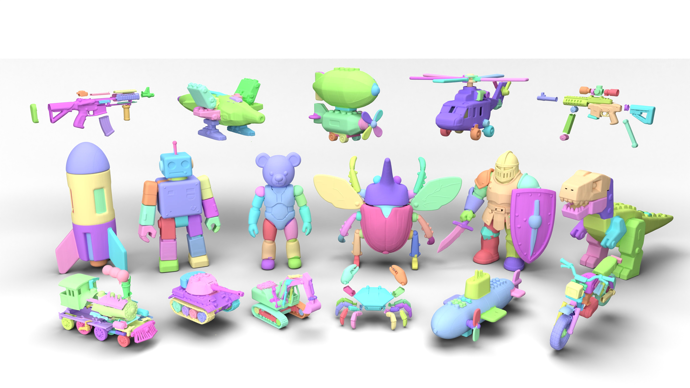
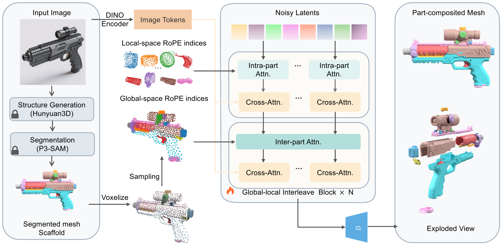

# StructParts

**Seeing Both the Forest and the Trees: Reusing Holistic 3D Priors for Part-Decomposed Generation**

**NeurIPS 2026**

[Project page](https://zhao-yiqun.github.io/structparts/) · [Model weights](https://huggingface.co/Goatzyq/structparts) · [Citation](#citation)

Yiqun Zhao¹˒², Binbin Huang¹˒², Haobin Duan¹˒², Zibo Zhao³, Shenghua Gao¹˒²˒⁴*

¹ The University of Hong Kong · ² Transengram
³ Tencent · ⁴ Shenzhen Loop Area Institute

*Corresponding author: Shenghua Gao.*

[](https://zhao-yiqun.github.io/structparts/)

Watch the 24-second teaser film on the project page.

## Inference release

Minimal image-conditioned part generation from a segmented 3D scaffold. The input segmentation and 2D foreground mask are supplied by the user. This repository contains the inference model, preprocessing, mesh decoder and one configuration.

StructParts reuses a holistic 3D prior through dual-frame coordinate interleaving to combine detail within each part with coherence across the whole object.



## Setup

Clone the repository:

```bash
git clone https://github.com/zhao-yiqun/structparts-code.git
cd structparts-code
```

Use Python 3.10 and a CUDA GPU supporting BF16. Install the CUDA build of PyTorch appropriate for your system, then install the remaining dependencies:

```bash
python -m pip install -r requirements.txt
```

Our release contains **two** weight artifacts:

| File | Component | Size |
| --- | --- | --- |
| `dit.safetensors` | Part diffusion transformer | 6.10 GB |
| `vae_decoder.safetensors` | VAE mesh decoder | 0.43 GB |

Download our weights from [Goatzyq/structparts on Hugging Face](https://huggingface.co/Goatzyq/structparts): [DiT](https://huggingface.co/Goatzyq/structparts/resolve/main/dit.safetensors) and [VAE decoder](https://huggingface.co/Goatzyq/structparts/resolve/main/vae_decoder.safetensors). Place both files in `checkpoints/`. These two artifacts are BF16; `checkpoints/manifest.json` records their SHA-256 hashes.

From the root of this inference repository:

```bash
python -m pip install "huggingface_hub>=0.34,<1.0"
hf download Goatzyq/structparts dit.safetensors vae_decoder.safetensors manifest.json --local-dir checkpoints
```

During preparation, the model repository is private: authorized collaborators must first run `hf auth login`. After publication, public downloads will be available without that private-repository authorization. These files provide our diffusion transformer and VAE decoder only; download DINOv2 separately as described below.

### Download DINOv2 separately

**We do not distribute DINOv2 checkpoints, including converted or embedded copies in release packages.** Obtain the **DINOv2-large / ViT-L/14 model without registers** directly from [Meta's upstream repository](https://github.com/facebookresearch/dinov2#pretrained-models). This implementation uses the Transformers-format weights from [facebook/dinov2-large](https://huggingface.co/facebook/dinov2-large).

Download the compatible upstream revision yourself:

```bash
python scripts/download_dinov2.py
```

The helper fetches `config.json` and `model.safetensors` directly from `facebook/dinov2-large` at revision `47b73eefe95e8d44ec3623f8890bd894b6ea2d6c`, placing them in `checkpoints/dinov2-large/`. Alternatively, download these two files from the model repository and place them there manually. The original PyTorch-Hub `.pth` file uses a different key format and cannot simply be renamed to `.safetensors`.

Inference strictly loads the user-downloaded `checkpoints/dinov2-large/model.safetensors` locally and follows the original FP32 → FP16 → BF16 conversion for the frozen encoder. This reproduces all 439 encoder tensors from the original checkpoint exactly. It does not download weights during inference. The existing preprocessing is retained. The DINOv2 directory is Git-ignored, and `scripts/package_release.py` excludes its weights even when `--include-weights` is used.

PyTorch SDPA works without FlashAttention. If installed, FlashAttention 3 is selected on Hopper GPUs, otherwise FlashAttention 2 is used when available. Set `--attention sdpa` to force PyTorch attention. For the original GPU surface extractor, install `cubvh` with `sparse_marching_cubes` support. Without it, the decoder uses scikit-image marching cubes, whose triangulation can differ.

## Inference

A prepared object directory has four files:

```text
object/
  0.png                 # input RGB or RGBA image
  mask_id/0.png         # image mask for foreground cropping
  p3sam_mesh.glb        # segmented scaffold mesh
  p3sam_labels.npy      # one integer part ID per triangle
```

Use the same mesh loading order as `trimesh.load(..., force="mesh", process=False)` when creating face labels. A binary foreground mask with values 0/255 is supported. Existing mask-ID images are also accepted; preprocessing uses the original foreground threshold of 76.5. An empty mask is rejected. The image and scaffold must represent the same object and view.

```bash
python infer.py --input-dir /path/to/object --output results/object
```

Or pass the four paths explicitly:

```bash
python infer.py --image image.png --mask foreground.png \
  --mesh scaffold.glb --labels face_labels.npy --output results/object
```

The default configuration uses 1,024 voxel tokens per part, a 1,022-pixel image, 50 Euler sampling iterations, CFG scale 5 and a 512-resolution mesh decoder. Up to 50 parts are supported. These values are in `configs/inference.yaml`; `--steps`, `--resolution`, `--seed` and `--guidance-scale` override sampling settings. Decoder resolution must be a power of two. For a lighter run, use `--resolution 256`.

Outputs are `part_<id>.glb`, `scene.glb` (separate named part geometries) and `result.json`. Part IDs come from the input face labels. Meshes are returned in the input scaffold's coordinate frame. Choose a new output folder for each run.

Validate inputs or strictly check all model weights:

```bash
python infer.py --input-dir /path/to/object --prepare-only
python infer.py --check-weights --device cpu
```

## Layout

```text
infer.py                   # command-line entry
configs/inference.yaml     # inference parameters
structparts/               # preprocessing, sampling and required model code
checkpoints/               # our two artifacts; user downloads DINOv2 into a separate ignored subdirectory
assets/                    # teaser and pipeline figures
requirements.txt
LICENSE
Notice.txt
```

The model code derives from the existing StructParts / UltraShape / Hunyuan3D implementation. Original copyright and license notices are retained in `LICENSE`, `Notice.txt` and source headers. DINOv2 is used through Transformers; its model license is [Apache 2.0](https://github.com/facebookresearch/dinov2/blob/main/LICENSE), included in `licenses/DINOv2-Apache-2.0.txt`.

## Acknowledgments

We thank [Hunyuan3D-2.1](https://github.com/Tencent-Hunyuan/Hunyuan3D-2.1) and [UltraShape-1.0](https://github.com/PKU-YuanGroup/UltraShape-1.0) for their open-source models and implementations, which our work builds upon. Original license and copyright notices are retained in the inference code.

## Citation

```bibtex
@inproceedings{zhao2026structparts,
  title = {Seeing Both the Forest and the Trees: Reusing Holistic 3D Priors for Part-Decomposed Generation},
  author = {Zhao, Yiqun and Huang, Binbin and Duan, Haobin and Zhao, Zibo and Gao, Shenghua},
  booktitle = {Advances in Neural Information Processing Systems},
  year = {2026},
  url = {https://zhao-yiqun.github.io/structparts/}
}
```
